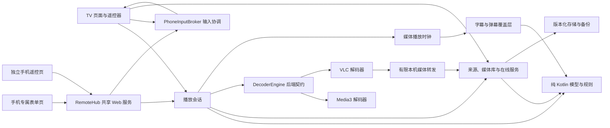

# 架构与重写审查

本文件描述新工程的职责和审查边界，实际实现、构建、服务与设备验证结果统一记录在 [功能状态](功能状态.md)。需求来源见 [需求核对](需求核对.md)，不能把接入库或定义接口视为实际验收通过。

## 为什么从 TV 的会话和导航开始

播放会话是唯一音视频状态源。遥控器和手机命令都调用会话，不通过页面状态猜测播放器状态。生命周期负责暂停和释放，弹幕与字幕根据媒体时间定位，避免 seek、倍速和切集后各自继续跑墙钟。

TV 页面对“当前可以做什么”负责：初始焦点、可见焦点、方向键路径、返回路径、加载、失败、空态。全部文字输入由页面声明本次操作的专属表单，手机浏览器填写，电视仅展示二维码、地址和取消入口。网络和文件读取由后台任务完成，页面隐藏后令旧请求及待输入失效。页面和持久化模型之间只交换明确的媒体、来源、进度与设置。

## 双内核与媒体来源

`PlayerSession` 持有单个有效解码后端，`DecoderEngine` 定义准备、播放、暂停、定位、倍速、音量、轨道、比例、字幕样式与释放。Media3 和 VLC 使用该契约接入同一会话；远程服务、TV 控制、进度保存、字幕和弹幕不分别维护播放器。

切换前记录媒体位置、播放意图、倍速、音量和可恢复的轨道设置，释放旧后端后创建新后端并恢复。后台状态不因切换或重试恢复声音；失败时提供原因、重试和换内核入口。轨道使用可恢复选择信息，不能假定两个库拥有相同轨道 ID。VLC 的准备依赖其播放事件，准备阶段与已暂停状态的静音和恢复需要专门回归，不能仅凭最终 UI 状态推断没有短暂出声。

来源协议与具体播放器解耦。Media3 使用新工程的数据源适配读取本地授权文件、HTTP/WebDAV、SMB 和 FTP。VLC 对无认证的公开 HTTP 流使用原 URL，保留 HLS/DASH 相对分片地址；其他文件来源可通过 `MediaRelay` 接入已有随机读取能力。转发只监听本机回环地址，使用不可预测路径、有限工作线程和排队、请求超时与请求大小限制，处理 GET/HEAD 和字节范围。会话关闭时关闭监听、连接及来源读取器，不无限创建连接或缓存整部视频。

本机转发处理单个媒体字节流，不代理清单及其所有分片。带认证的 HLS/DASH 必须使用 Media3，不能把“单文件能转发”当成 VLC 已支持所有认证流。随机读取、未知长度、服务忽略 Range、短响应、断线及关闭期间的读取需独立验收；真实 NAS 或直播流的互操作结论记录在功能状态中。

## 字幕、弹幕与在线服务

在线字幕使用 OpenSubtitles 正式协议，配置与弹弹play 开发者凭证独立。搜索按名称、语言和可取得的文件指纹返回候选，下载处理账户认证、服务配额和缓存。自动匹配仅在取得真实大小与完整首尾片段、返回唯一可靠语言结果时下载；指纹无法读取时不伪造哈希。未配置、认证失败或配额耗尽不阻断本地字幕路径；测试服务的协议响应不能代替正式账户下载证据。

字幕导入区分字节解码、文字/时序与播放器原生样式。自动编码检测可被手选编码纠正；普通文字覆盖层与原生字幕共享媒体时间。VLC 提供原生 ASS 与媒体字体附件路径，导入字体在需要时通过会话重建恢复播放。ASS 文件自带样式优先；字幕描边在覆盖层、Media3 和 VLC 上具有不同实现能力，Media3 原生字幕提供描边开关并采用其默认粗细，不能承诺不同后端像素效果完全相同。具体编码、字体附件与 ASS 特效需真实样本。

弹幕语言转换由数据职责使用 Opencc4j 的本地字典完成，UI 只提交原始/简体/繁体选择。云屏蔽使用 [Cathgao/dandanplay-filter](https://github.com/Cathgao/dandanplay-filter) 公开仓库的离线基线及主动 HTTPS 拉取，不代表官方服务器推送。刷新 12 个分类使用 20 秒总预算、字节和条数限制，全部读取、解析与保存成功后才发布新缓存；失败保留现有规则。RE2/J 不支持的规则被跳过并显示数量，不假装全部生效。公开规则与自定义规则分别控制，文字转换、筛选和密集窗口计算不得阻塞播放线程。

番剧服务负责每周、季度、搜索、详情、剧集匹配和弹幕下载，应用鉴权不等于用户登录。网络服务与媒体来源分开，断网或缺少服务凭证不阻断本地观看。远程 `/api/config` 与 TV 设置进入同一配置模型，逐项覆盖弹幕样式、显示类型、数量/区域、屏蔽和语言选择，并反映到当前会话。

## 媒体库与数据事务

媒体来源、收藏、观看历史、剧集绑定和索引使用稳定媒体编号关联。后台扫描真实目录并持久化索引，支持取消、重扫、失败和预算状态；达到预算或取消不能发布“完整扫描”的状态。搜索过滤作用于真实条目，分页只控制界面规模，不改变条目身份。来源删除、备份恢复和数据清除应使旧任务失效，防止旧扫描或播放进度回写覆盖新数据。

持久化职责通过明确模型与存储接口隔离 Android 环境。设备存储使用原子文件写入；可独立执行的存储测试使用 NIO 实现验证事务行为。跨实例更新、读取失败、提交失败和原子替换都需测试，只有写入确认成功后才对外发布新的内存状态。存储格式不成为 UI 隐式 API，底层实现可以替换。

备份有显式版本和公开/密码两种模式。公开备份排除秘密；密码备份以 AES-GCM 与 PBKDF2 保护用户明确选择携带的网络凭据及开发者密钥，不导出本机 Keystore 密钥或 OpenSubtitles 凭证。导入先验证字段、媒体地址、配置、关联与预算，再展示替换摘要，经用户确认后原子替换；失败不清空原数据。视频、字幕文件与本地目录授权不随备份迁移，目标设备提供重新授权和服务配置入口。旧数据库迁移需独立契约，不直接链接旧实现。

## 手机输入与服务生命周期

MainActivity 初始化时异步准备 RemoteHub 的应用级 HTTP 服务，手机输入、遥控及 URL 投送接口共享一个端口和配对令牌。输入页 `/input/{sessionId}` 绑定单次操作，首页 `/` 仅提供遥控，页面职责分开。服务不由某个页面或播放器重复创建。设置允许停止服务或重新配对；停止会关闭连接并取消待输入，后续文字输入自动重新启动。服务随应用进程运行，不保证 Android 后台永久保活。

PhoneInputBroker 负责当前输入请求、电视等待弹窗、专属二维码、十分钟有效期与所属页面的取消。表单按整页提交，业务校验由请求方提供，成功后在主线程继续当前操作。页面隐藏、播放器切集或退出撤销所属输入，请求 ID 和一次性消费防止迟到内容作用于新页面。专属网页只能读取或提交自身 ID，成功、取消或过期显示结束，不自动跟随下一输入；校验失败保留编辑状态，并忽略过时响应。

添加媒体源的专属表单在手机上选择来源类型，并按类型显示名称、地址和账号密码。表单模型支持允许选项及条件字段，服务端验证条件必填并排除隐藏值，不能只依赖网页隐藏。选择本地目录后由 TV 调用系统授权，手机表单只提供名称与类型，不能授予电视文件权限。

网页所有 API 使用 Bearer 令牌鉴权；未配对的静态网页不包含受保护信息。当前标签页通过 sessionStorage 保留配对令牌，刷新或进入新的专属路径可复用令牌，但页面绑定的表单 ID 不会自动改变。已保存秘密只返回是否存在，网页留空保留原值，显式清除才能删除。当前使用可信局域网中的 HTTP，传输未经过 TLS 加密；此边界与密钥在设备上的 Keystore 加密存储分别说明。

## 完整性审查

| 能力 | 决策与影响 |
| --- | --- |
| 双内核 | Media3/VLC 接入统一会话；核验切换恢复、释放、音频焦点、选轨及各协议边界 |
| 在线字幕 | OpenSubtitles 正式协议与可靠自动匹配；区分模拟协议测试、正式账户成功和配额条件 |
| 远程投屏 | 新版支持 URL 投送和遥控；旧文档未公开媒体投送和 AES 细节，不假设兼容 |
| 文字输入 | 媒体源、链接、搜索、凭证和屏蔽规则各有专属手机表单；TV 入口、条件字段、取消、结束及提交后焦点都要验收 |
| 弹幕云屏蔽/简繁 | 公开仓库主动拉取与缓存、本地字典转换；核验刷新失败保留、跳过规则、语言变化及远程一致性 |
| 登录注册 | 旧文档明确停用；新产品本地使用不依赖账号，未来通过独立鉴权适配接入 |
| 下载/Torrent | 旧文档明确 Torrent 未完成；按明确新需求独立扩展，不作为原已可用功能的恢复门槛 |
| 字体/编码/样式 | 自动及手选编码、字体导入、VLC 原生 ASS 与字幕描边各有路径；真实画面和媒体样本分别验收 |
| 收藏/索引/备份 | 核验真实扫描、取消/重扫、删除来源、秘密排除、密码错误和恢复事务；旧数据库兼容需另有样本与契约 |
| TV 系统能力 | 基础无障碍名称、焦点和可读反馈属于交互质量；语音与 Watch Next 可独立扩展，真实盒子性能不可凭模拟器推断 |

## 过度限制检查

新工程不依赖旧模块、存储模型、基类、资源或构建，UI 与领域不绑定旧模板。构建模块数量按实际职责决定，不为每个页面拆一个模块。原生 View、Media3/VLC、协议库和存储接口属于当前实现，可以在行为契约与职责清晰的条件下替换或继续扩展。

来源协议独立处理：SMB、FTP 和 WebDAV 不共享一个充满分支的“万能文件类”。在线服务与媒体来源不互相依赖，断网或凭证缺失不阻断本地播放。安全与性能预算属于可测行为约束，不冻结具体库或实现方式。

## 重构风险检查

1. 纯 Kotlin 的定位、续播、按键、弹幕与字幕规则可通过单元测试重构。
2. 数据存储有显式模型；网络秘密单独加密，不能把持久化格式成为 UI 的隐式 API。
3. 第三方播放器生命周期在会话层集中，不允许页面和远程服务各建一个全局播放器。
4. 新协议与旧协议有不同边界，未来兼容适配应独立于播放内核。
5. 现阶段没有为了“未来无限扩展”引入反射插件、热修复、复杂依赖注入或通用事件系统；当规模增长时用真实使用点确定接口。

## 审查依据

功能范围仅依据旧产品 README、产品文档与用户确认，不读取旧实现。服务协议、来源与依赖以公开协议及新工程接入为依据。代码审查检查实际调用链、失败行为、资源释放、状态恢复和事务提交；构建、测试、正式服务与遥控器验收分别记录证据。结论与修复写入功能状态，不在本文件保留临时任务队列或未经验证的完成声明。
